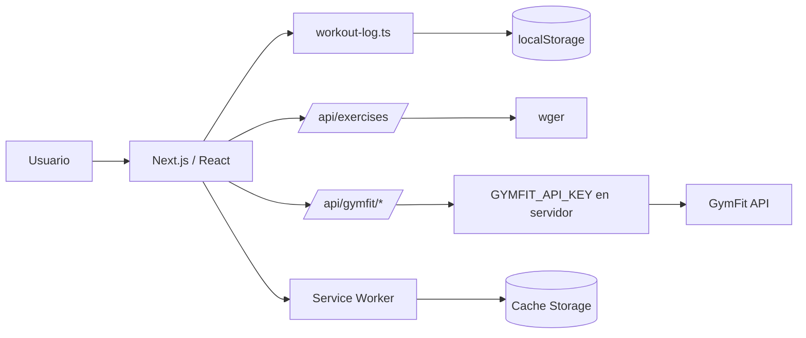

# Documentación funcional y técnica — My Workout App

> Estado documentado: 2 de noviembre de 2026. Este documento describe el comportamiento encontrado en el código actual; no representa una especificación futura ni implica que las funcionalidades estén verificadas en producción.

## 1. Resumen

My Workout App es una aplicación web en español para registrar sesiones de fuerza, consultar el historial en un calendario y explorar ejercicios. Está orientada al uso móvil y puede instalarse como PWA. No hay cuentas ni servidor propio de persistencia: las sesiones y preferencias se guardan en el almacenamiento local del navegador. Los catálogos de ejercicios se obtienen de servicios externos mediante rutas API del servidor Next.js.

La pantalla principal reúne cinco secciones conmutables: **Inicio**, **Entrenar**, **Calendario**, **Ejercicios (wger)** y **Rutinas**. Inicio es la vista predeterminada y reúne un hero con la mancuerna de marca y accesos a las acciones más frecuentes. Desde la biblioteca se puede abrir un explorador separado de GymFit, con búsqueda de ejercicios y músculos. Las páginas de detalle de ambas fuentes se abren en rutas propias.

## 2. Funcionalidades y flujos

### 2.1 Entrenamiento libre

En la sección **Entrenar**, el usuario puede:

- Comenzar una sesión libre, que se crea con la fecha local y queda en estado `in_progress`.
- Buscar ejercicios en la API de wger y añadir resultados a la sesión.
- Añadir ejercicios manuales con un nombre escrito por el usuario.
- Para cada ejercicio, añadir series; cada serie permite registrar repeticiones, peso en kg y estado completado.
- Al completar una serie se inicia un descanso de 90 segundos. El temporizador se asocia a la sesión mediante `restEndsAt`.
- Añadir notas a la sesión, retirar un ejercicio y finalizar una sesión que contenga al menos un ejercicio.
- Al finalizar, la sesión pasa a `completed` y se guarda `endedAt`.
- Se puede finalizar aunque no haya ejercicios; en ese caso la sesión se descarta y no entra al historial.
- La pantalla inicial permite empezar sin rutina o elegir una plantilla guardada. También se puede iniciar desde la sección Rutinas.
- Una sesión creada desde rutina copia su nombre, ejercicios y número de series. En ese flujo se registra el peso por serie; el historial mantiene su propia copia aunque la plantilla se edite o elimine.
- Una rutina en curso se puede cancelar con confirmación; cancelar la elimina del historial local y descarta sus datos.

Las sesiones se escriben en `localStorage` cuando cambia el estado de la pantalla. Si el almacenamiento no está disponible o está lleno, `writeWorkoutLog` captura el error para mantener la sesión actual utilizable; no ofrece sincronización remota.

### 2.2 Calendario e historial

- Presenta un mes por vez, con controles para avanzar o retroceder y selección de un día.
- Marca el día actual y días con sesiones; distingue sesiones completadas y en curso.
- En el panel del día seleccionado presenta estado, cantidad de ejercicios, series completadas y notas.
- Cada sesión completada se puede editar desde ese día: fecha, notas, nombre de la rutina en el registro, ejercicios, cantidad de series, pesos, repeticiones de entrenamientos libres y marcado de series realizadas. Se pueden agregar o quitar ejercicios y series.
- Permite iniciar un entrenamiento para el día seleccionado o volver a la sesión en curso.
- El resumen de la sección muestra el total de sesiones completadas y la fecha de la sesión más reciente.

El selector abre por defecto en el día local actual. Si existe una sesión en curso, la acción del calendario lleva a Entrenar para continuarla en lugar de crear otra.

### 2.3 Rutinas

- La sección dedicada permite crear, editar y eliminar plantillas locales.
- Cada plantilla guarda nombre y ejercicios de wger con cantidad fija de series por ejercicio. La búsqueda sugiere resultados al escribir al menos dos caracteres.
- El orden de ejercicios se puede cambiar y cada cantidad se ajusta antes de guardar; no se guarda peso en la plantilla.
- La rutina se puede iniciar desde su tarjeta o desde Entrenar. Al iniciarla se genera una sesión nueva para la fecha local, con una copia de los ejercicios y series vacías para completar el peso.
- Al finalizar una sesión con rutina, se registra la fecha local de finalización y `endedAt`, junto con los pesos anotados.
- Las sesiones guardan `routineId` y `routineName`; los datos de ejecución permanecen en el registro aunque la plantilla original se modifique o elimine.

La clave de almacenamiento es `gym-systems.routines.v1`. Las rutinas comparten la misma limitación de almacenamiento por navegador que el historial.

### 2.4 Biblioteca principal: wger

En **Ejercicios** la app consulta inicialmente el catálogo en español y permite:

- Buscar por texto, ejecutar búsquedas rápidas por grupo muscular o equipamiento y actualizar resultados.
- Ver resultados como tarjetas o como JSON técnico.
- Abrir el detalle de un ejercicio en un modal, con pestañas de detalles/músculos, multimedia e información JSON.
- Desde el modal, copiar la respuesta JSON al portapapeles.
- Abrir la ruta de detalle de wger desde la tarjeta (según componente/ruta disponible).
- Abrir la biblioteca GymFit mediante una tarjeta de navegación.

La lista inicial solicita 18 resultados. La API interna acepta `limit` y `offset`; la respuesta conserva enlaces `next`/`previous` de wger. La disponibilidad de descripciones, traducciones e imágenes depende del registro externo. Para mostrar nombre/descripción, el modal prioriza español (`language=4`), luego inglés (`language=2`) y luego la primera traducción disponible.

### 2.5 Explorador GymFit

La ruta `/gymfit` presenta el componente de exploración avanzada. Sus vistas son:

- **Ejercicios:** búsqueda con sugerencias cuando hay al menos dos caracteres (retardo de 300 ms), filtros por equipamiento, grupo muscular, dificultad y tipo, orden, facetas, páginas de 18 resultados y enlaces al detalle.
- **Músculos:** búsqueda por texto y grupo muscular, consulta de grupos musculares, selección de músculo y carga de ejercicios asociados.
- **Detalle de ejercicio:** página `/ejercicios/gymfit/[id]` que consulta el detalle del ejercicio y sus recursos asociados, incluyendo alternativas y mapa muscular según la API disponible.
- **Detalle de músculo:** consulta interna de `/api/gymfit/muscles/[id]` desde el flujo de selección.

La ruta `/ejercicios/gymfit` también existe como explorador simplificado con búsqueda y resultados; las tarjetas del explorador avanzado apuntan a `/ejercicios/gymfit/[slug-o-id]`.

Los valores comunes de categorías y filtros tienen traducciones visibles al español; los nombres y descripciones que proporciona GymFit pueden permanecer en su idioma de origen. Todas las funciones GymFit dependen de `GYMFIT_API_KEY` en el entorno de servidor. Si falta, las rutas responden con estado 503.

### 2.6 Apariencia y navegación

- Inicio presenta una acción principal para comenzar un entrenamiento libre o continuar la sesión en curso; también permite ir a Rutinas, Calendario y Ejercicios.
- La mancuerna del hero es una imagen estática con animación CSS sutil de flotación e inclinación; la animación se desactiva con `prefers-reduced-motion`.
- Navegación de la aplicación principal entre Inicio, Entrenar, Calendario, Ejercicios y Rutinas.
- En pantallas pequeñas se muestra una barra de navegación inferior.
- Preferencia de tema claro u oscuro.
- Cinco paletas de acento: naranja, azul, rojo, rosa y violeta.
- Tema y paleta se guardan en `localStorage` y se aplican en variables CSS globales.
- El panel de apariencia se puede cerrar con Escape.

### 2.6 Instalación y acceso rápido (PWA)

- `manifest.ts` define nombre, iconos instalables de la mancuerna cromada, pantalla de inicio, modo independiente y orientación vertical. Los iconos PWA incluyen variantes de 192 y 512 px, además de un icono maskable; iOS usa la misma identidad en `apple-touch-icon.png`.
- En producción, `PwaOnboarding` intenta registrar `public/sw.js`.
- La interfaz detecta iOS, Android o escritorio, captura el evento de instalación cuando el navegador lo ofrece y explica cómo instalar o guardar un favorito.
- La invitación se muestra después de un breve retardo si la app no está instalada y no fue descartada previamente; el botón de encabezado puede volver a abrirla.
- El Service Worker guarda navegación visitada, recursos estáticos, la imagen de Inicio y hasta 24 respuestas de `/api/exercises`. Si falla la navegación, intenta usar la página en caché y luego `offline.html`.

El soporte offline no equivale a disponibilidad total de la app: el registro de entrenamientos es local, pero GymFit y nuevas consultas externas necesitan conexión; las búsquedas wger solo pueden reutilizar respuestas previamente almacenadas por el Service Worker.

## 3. Rutas

### Interfaz

| Ruta | Uso |
| --- | --- |
| `/` | Sección Inicio predeterminada, entrenamiento, calendario e interfaz wger; admite `?library=wger` para abrir la sección de ejercicios. |
| `/gymfit` | Explorador avanzado GymFit. |
| `/ejercicios/wger/[id]` | Ruta de detalle asociada a un ejercicio wger. |
| `/ejercicios/gymfit` | Explorador GymFit simplificado. |
| `/ejercicios/gymfit/[id]` | Detalle GymFit. |
| `/manifest.webmanifest` | Manifiesto PWA generado por Next.js. |
| `/offline.html` | Página estática de respaldo offline. |

### API interna

| Método y ruta | Propósito y parámetros principales |
| --- | --- |
| `GET /api/exercises` | Proxy wger: `search`, `limit`, `offset`; idioma español. |
| `GET /api/exercises/[id]` | Detalle de ejercicio wger. |
| `GET /api/gymfit/exercises` | Búsqueda GymFit y facetas; consulta, límite, offset y filtros permitidos por el proxy. |
| `GET /api/gymfit/exercises/suggest` | Sugerencias GymFit; `q`, mínimo dos caracteres, hasta seis sugerencias. |
| `GET /api/gymfit/exercises/[id]` | Detalle GymFit. |
| `GET /api/gymfit/exercises/[id]/alternatives` | Alternativas GymFit; acepta `limit`. |
| `GET /api/gymfit/exercises/[id]/heatmap` | Mapa muscular SVG; `view=front|back`. |
| `GET /api/gymfit/muscle-groups` | Catálogo de grupos musculares. |
| `GET /api/gymfit/muscles` | Búsqueda de músculos; `query`, `bodyPart`, `group`, `limit`, `offset`. |
| `GET /api/gymfit/muscles/[id]` | Detalle de músculo. |
| `GET /api/gymfit/muscles/[id]/exercises` | Ejercicios de músculo; proxy de filtros admitidos. |

Los proxies GymFit agregan `X-API-KEY` en servidor. En general reenvían el estado de la API externa; errores de conexión se normalizan como 502 y ausencia de clave como 503. Las cachés de Next se configuran por ruta: GymFit usa 60 s para búsqueda, 300 s para sugerencias de datos de músculo/detalle y ejercicios de músculo, 300 s para detalle/alternativas, 3600 s para heatmap/detalle músculo y 86400 s para grupos; sugerencias de texto usa `no-store`. wger lista usa 60 s y detalle 300 s.

## 4. Datos y persistencia

### Sesiones

Clave de almacenamiento: `gym-systems.workout-log.v1`.

```ts
type WorkoutSet = {
  id: string;
  reps: number | null;
  weight: number | null;
  completed: boolean;
};

type WorkoutExercise = {
  id: string;
  wgerId?: number;
  name: string;
  sets: WorkoutSet[];
};

type WorkoutSession = {
  id: string;
  date: string; // YYYY-MM-DD, fecha local
  startedAt: string; // ISO timestamp
  endedAt?: string;
  status: "in_progress" | "completed";
  routineId?: string;
  routineName?: string;
  exercises: WorkoutExercise[];
  notes: string;
  restEndsAt?: number; // timestamp en milisegundos
};
```

El contenedor persistido es `{ version: 1, sessions: WorkoutSession[] }`. Si la lectura falla, la versión no coincide o los datos no tienen la forma exterior esperada, se inicializa una lista vacía. No hay migración, validación profunda, exportación ni importación implementadas.

### Rutinas

Clave: `gym-systems.routines.v1`.

```ts
type RoutineExercise = {
  id: string;
  name: string;
  wgerId: number;
  setCount: number;
};

type WorkoutRoutine = {
  id: string;
  name: string;
  exercises: RoutineExercise[];
  createdAt: string;
  updatedAt: string;
};
```

Al iniciar, los elementos de la plantilla se convierten en `WorkoutExercise` y `WorkoutSet` nuevos dentro de la sesión. Por diseño, los cambios posteriores a la plantilla no reescriben sesiones existentes.

### Otras claves locales

| Clave | Contenido |
| --- | --- |
| `my-workout-app.theme` | `light` o `dark`. |
| `my-workout-app.color-theme` | Paleta seleccionada. |
| `my-workout-app.install-invite-dismissed` | Si se descartó la invitación PWA. |
| `gym-systems.routines.v1` | Rutinas guardadas localmente. |

No hay backend de usuarios, base de datos, sincronización entre dispositivos ni analítica de progreso basada en historial.

## 5. Arquitectura y tecnologías

| Área | Implementación actual |
| --- | --- |
| Framework | Next.js 16.4.3, App Router y Route Handlers. |
| UI | React 19.3, TypeScript. |
| Estilos | Tailwind CSS 4 y `src/app/globals.css` con tokens CSS. |
| Iconos | Lucide React. |
| Historial y ajustes | `localStorage` del navegador. |
| Catálogo público | wger REST API. |
| Catálogo avanzado | GymFit API v2 desde proxies propios. |
| Instalación/offline | Web App Manifest, Service Worker y Cache Storage. |



Los principales puntos de entrada de código son `src/app/page.tsx` (shell, navegación, estado compartido y biblioteca wger), `src/components/HomeWorkspace.tsx` (hero y accesos rápidos), `src/components/WorkoutWorkspace.tsx` (entrenamiento y calendario), `src/components/GymFitExerciseLibrary.tsx`, los detalles de ejercicio, `src/lib/workout-log.ts` y los Route Handlers de `src/app/api/`.

## 6. Estructura del proyecto

```text
src/
├── app/
│   ├── api/                  # Proxies wger y GymFit
│   ├── ejercicios/           # Exploradores y páginas de detalle
│   ├── gymfit/               # Página de exploración avanzada
│   ├── globals.css           # Tokens, temas y responsive
│   ├── layout.tsx            # Layout raíz, metadata y viewport
│   ├── manifest.ts           # Manifiesto PWA
│   └── page.tsx              # Shell, navegación y biblioteca principal
├── components/
│   ├── HomeWorkspace.tsx     # Hero de Inicio y accesos rápidos
│   └── ...                   # Flujos y componentes de interfaz
├── lib/workout-log.ts        # Modelo y persistencia local de sesiones
├── lib/routines.ts           # Modelo y persistencia local de rutinas
└── types/                    # Contratos wger y GymFit
public/
├── sw.js                     # Service Worker
├── offline.html              # Respaldo offline
├── my-workout-dumbbell.png   # Imagen del hero de Inicio
└── pwa-*.png                 # Iconos instalables
```

## 7. Configuración y comandos

Para habilitar GymFit, configurar en el entorno del servidor:

```env
GYMFIT_API_KEY=tu_clave_privada
```

No usar el prefijo `NEXT_PUBLIC_`: la clave se utiliza solo en Route Handlers.

```bash
npm install
npm run dev
npm run lint
npm run build
npm start
```

## 8. Límites y puntos a discutir para mejoras

Esta sección identifica restricciones que surgen de la implementación; no prescribe una solución ni adelanta cambios.

- Los datos de entrenamiento dependen del navegador y dispositivo. Borrar datos del sitio puede borrar el historial.
- Solo se modela una sesión en curso de forma práctica: la acción de continuar busca la primera sesión `in_progress`; no hay selector de sesiones activas ni regla visible de unicidad aplicada al modelo.
- La cancelación elimina definitivamente la sesión local en curso después de la confirmación; no existe papelera ni recuperación.
- Las rutinas y las sesiones se guardan en claves locales separadas; la pérdida o limpieza de datos del sitio puede borrar ambas.
- El modelo no registra unidades distintas de kg, descanso configurable, duración total calculada ni relación con una rutina/plantilla.
- La lectura del registro valida versión y arreglo, no cada objeto anidado; errores de formato degradan a historial vacío.
- `writeWorkoutLog` absorbe fallos de almacenamiento sin notificar en la interfaz.
- Los catálogos y detalles dependen de disponibilidad, cobertura lingüística y límites de wger/GymFit.
- La PWA cachea las rutas API wger de lista, pero el Service Worker no define estrategia offline para los endpoints GymFit.
- La aplicación principal mezcla estado de navegación, apariencia, persistencia y consulta wger en `page.tsx`; `WorkoutWorkspace` contiene tanto el flujo de entrenamiento como el calendario.
- Al iniciar una rutina se registran pesos por serie, pero la pantalla de ejecución de rutina no solicita repeticiones; el flujo libre mantiene su campo de repeticiones.
- Hay una ruta GymFit simplificada y otra avanzada; conviene definir si ambas deben mantenerse como experiencias separadas.
- No se encontró una capa de dominio o persistencia remota para usuarios y sesiones; una evolución a sincronización implicaría decisiones de identidad, conflicto, migración y privacidad.

## 9. Privacidad y seguridad

- Las sesiones, notas y ajustes permanecen en almacenamiento local del navegador; no se envían a un backend propio.
- Las búsquedas y selecciones de ejercicios sí se consultan a los proveedores externos mediante el servidor de la app.
- La clave GymFit debe protegerse en variables de entorno del servidor y no incluirse en respuestas al cliente.
- El historial puede contener información personal y queda sujeto al acceso al navegador/dispositivo.

## 10. Convención de trabajo para las próximas mejoras

Esta documentación sirve como mapa del comportamiento actual para discutir propuestas. Durante la etapa de preguntas y diseño se pueden aclarar objetivos, flujos, reglas y alternativas sin cambiar código. La implementación comienza cuando el usuario indique explícitamente que se va a modificar código; después se revisan los cambios antes de dar la feature por definida.
