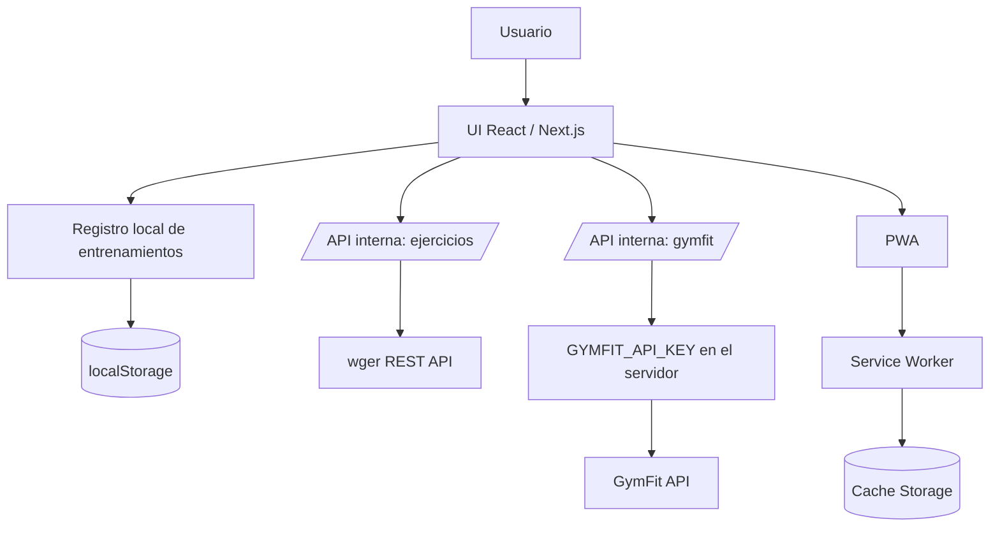

# My Workout App

## 1. Propósito

My Workout App es una aplicación web para registrar entrenamientos mientras se realizan y consultar bibliotecas de ejercicios. Está pensada para usarse desde el teléfono durante una sesión: permite crear un entrenamiento, anotar series, repeticiones y peso, controlar el descanso, revisar el historial en un calendario y descubrir ejercicios.

La aplicación incluye tres áreas principales:

- **Entrenamiento libre:** registro de una sesión en curso, ejercicios, series, notas y cronómetro de descanso.
- **Calendario:** consulta de sesiones por fecha y creación o continuación de un entrenamiento para el día seleccionado.
- **Explorador de ejercicios:** búsqueda en la biblioteca abierta de wger y acceso al explorador avanzado de GymFit.

GymFit amplía el catálogo con sugerencias de búsqueda, filtros, exploración por músculos, detalle de ejercicios, alternativas y mapa muscular.

## 2. Tecnología

| Área | Implementación |
| --- | --- |
| Framework | Next.js 16 con App Router |
| Interfaz | React 19 y TypeScript |
| Estilos | Tailwind CSS 4 y variables CSS semánticas |
| Iconos | Lucide React |
| Persistencia de entrenamientos | `localStorage` del navegador |
| Datos de ejercicios | wger REST API y GymFit API |
| Aplicación instalable | Web App Manifest, Service Worker y caché Cache Storage |

## 3. Arquitectura general



El navegador solo conversa con las rutas internas de Next.js. Estas rutas actúan como adaptadores y proxies hacia las APIs externas. Esto permite mantener la clave de GymFit fuera del cliente, normalizar errores y definir la caché de cada consulta.

## 4. Rutas de interfaz

| Ruta | Propósito |
| --- | --- |
| `/` | Aplicación principal con entrenamiento libre, calendario y biblioteca wger. |
| `/gymfit` | Explorador avanzado de GymFit. |
| `/ejercicios/wger/[id]` | Detalle de un ejercicio proveniente de wger. |
| `/ejercicios/gymfit/[id]` | Detalle de un ejercicio de GymFit. |
| `/manifest.webmanifest` | Manifiesto generado por Next.js para la PWA. |

En móvil, la navegación principal se representa mediante una barra inferior con tres destinos: **Entrenar**, **Calendario** y **Explorar**. GymFit se abre desde una tarjeta explicativa dentro del explorador, para aclarar que ofrece filtros, sugerencias y navegación por músculos.

## 5. Componentes principales

### `src/app/page.tsx`

Es la pantalla principal y el coordinador de estado de la aplicación. Administra:

- La sección activa: entrenamiento, calendario o biblioteca.
- La lectura y escritura del historial local.
- El tema claro u oscuro y las paletas de color.
- La consulta de ejercicios de wger para la biblioteca principal.
- La barra móvil de navegación y el acceso a la instalación PWA.

### `src/components/WorkoutWorkspace.tsx`

Contiene las dos experiencias de entrenamiento:

- **Entrenamiento libre:** crea y edita la sesión en curso; agrega ejercicios desde wger o manualmente; permite registrar series, repeticiones, peso y notas; inicia un descanso de 90 segundos al completar una serie.
- **Calendario:** agrupa sesiones por fecha, muestra su estado y permite iniciar o continuar una sesión para el día seleccionado.

### `src/components/GymFitExerciseLibrary.tsx`

Implementa la biblioteca avanzada de GymFit:

- Búsqueda de ejercicios con sugerencias tras escribir al menos dos caracteres.
- Filtros por equipamiento, grupo muscular, dificultad, tipo y orden.
- Paginación de resultados.
- Exploración y detalle de músculos, junto con los ejercicios asociados.

### `src/components/ExerciseCard.tsx` y `src/components/ExerciseModal.tsx`

Presentan resultados de la biblioteca wger en formato de tarjetas y detalle modal.

### `src/components/ApiResponseViewer.tsx`

Muestra la respuesta cruda de wger cuando el usuario selecciona la vista técnica JSON.

### `src/components/PwaOnboarding.tsx`

Registra el Service Worker en producción y muestra la invitación de instalación. Cuando el navegador no expone un diálogo nativo, presenta pasos para instalar en iOS, Android o escritorio. También explica cómo guardar un favorito, ya que un sitio web no puede crear marcadores automáticamente.

## 6. Modelo de datos local

El historial se guarda en `localStorage` bajo la clave:

```text
gym-systems.workout-log.v1
```

La implementación está en `src/lib/workout-log.ts` y usa los siguientes tipos:

```ts
type WorkoutSet = {
  id: string;
  reps: number | null;
  weight: number | null;
  completed: boolean;
};

type WorkoutExercise = {
  id: string;
  wgerId?: number;
  name: string;
  sets: WorkoutSet[];
};

type WorkoutSession = {
  id: string;
  date: string; // YYYY-MM-DD en zona horaria local
  startedAt: string;
  endedAt?: string;
  status: "in_progress" | "completed";
  exercises: WorkoutExercise[];
  notes: string;
  restEndsAt?: number;
};
```

Cada vez que cambia el arreglo de sesiones, la pantalla principal lo persiste. El almacenamiento local permite usar la app sin cuenta, pero los datos están limitados al navegador y dispositivo actuales.

## 7. APIs internas

### wger

| Ruta interna | Uso | Caché de datos externos |
| --- | --- | --- |
| `GET /api/exercises` | Lista y busca ejercicios en español. Acepta `search`, `limit` y `offset`. | 60 s |
| `GET /api/exercises/[id]` | Obtiene el detalle de un ejercicio. | 300 s |

La integración consulta `https://wger.de/api/v2/exerciseinfo/` con `language=4`, correspondiente al idioma español. No requiere una clave privada.

### GymFit

| Ruta interna | Uso | Caché de datos externos |
| --- | --- | --- |
| `GET /api/gymfit/exercises` | Busca ejercicios y facetas. | 60 s |
| `GET /api/gymfit/exercises/suggest` | Sugiere ejercicios por texto. | Sin caché |
| `GET /api/gymfit/exercises/[id]` | Devuelve el detalle de un ejercicio. | 300 s |
| `GET /api/gymfit/exercises/[id]/alternatives` | Devuelve ejercicios alternativos. | 300 s |
| `GET /api/gymfit/exercises/[id]/heatmap` | Devuelve el SVG del mapa muscular. | 3600 s |
| `GET /api/gymfit/muscle-groups` | Lista los grupos musculares. | 86400 s |
| `GET /api/gymfit/muscles` | Busca músculos. | 300 s |
| `GET /api/gymfit/muscles/[id]` | Devuelve el detalle de un músculo. | 3600 s |
| `GET /api/gymfit/muscles/[id]/exercises` | Lista ejercicios asociados a un músculo. | 300 s |

Las rutas de GymFit validan identificadores y conservan la clave privada en el servidor. Los tipos de respuesta están definidos en `src/types/gymfit.ts`; los de wger, en `src/types/wger.ts`.

## 8. Configuración

### Requisito de entorno

Crear un archivo `.env.local` para habilitar GymFit:

```bash
GYMFIT_API_KEY=tu_clave_privada
```

La variable no debe exponerse con el prefijo `NEXT_PUBLIC_`, ya que solo la utilizan las rutas del servidor.

### Comandos

```bash
npm install
npm run dev
npm run lint
npm run build
npm start
```

La aplicación se abre durante el desarrollo en `http://localhost:3000`.

## 9. PWA y soporte sin conexión

La PWA se configura mediante:

- `src/app/manifest.ts`: nombre, iconos, orientación, modo independiente y colores del manifiesto.
- `src/app/layout.tsx`: metadata, icono de Apple y `viewport-fit=cover` para respetar áreas seguras en iOS.
- `src/components/PwaOnboarding.tsx`: registro del Service Worker e interfaz de instalación.
- `public/sw.js`: estrategias de caché.
- `public/offline.html`: pantalla de respaldo sin conexión.

El Service Worker usa estas estrategias:

| Recurso | Estrategia |
| --- | --- |
| Navegación de páginas | Red primero; usa página previamente guardada y luego `offline.html` si falla. |
| `/api/exercises` | Red primero; conserva hasta 24 respuestas de la búsqueda de wger. |
| Recursos estáticos de Next, iconos y manifiesto | Caché primero; descarga y guarda cuando aún no existe. |

El Service Worker se registra solo en producción. Para ofrecer instalación en un despliegue real, el sitio debe servirse por HTTPS.

## 10. Temas y diseño

El diseño usa variables CSS definidas en `src/app/globals.css`:

- Modo claro y oscuro.
- Paletas naranja, azul, rojo, rosa y violeta.
- Tokens para superficies, texto, acento, bordes y sombras.
- Adaptaciones móviles, incluyendo controles de al menos 16 px en campos de entrada para evitar el zoom automático de Safari.
- Barra inferior móvil que respeta `safe-area-inset-bottom`.

La selección de tema se guarda en:

```text
my-workout-app.theme
my-workout-app.color-theme
```

## 11. Estructura del proyecto

```text
src/
├── app/
│   ├── api/                         # Adaptadores y proxies de APIs externas
│   ├── ejercicios/
│   │   ├── gymfit/[id]/              # Detalle GymFit
│   │   └── wger/[id]/                # Detalle wger
│   ├── gymfit/                       # Página del explorador GymFit
│   ├── globals.css                   # Tokens, temas y reglas responsive
│   ├── layout.tsx                    # Metadata y viewport
│   ├── manifest.ts                   # Manifest PWA
│   └── page.tsx                      # Pantalla principal
├── components/                       # Componentes de UI y flujos de usuario
├── lib/workout-log.ts                # Persistencia y tipos del registro local
└── types/                            # Contratos TypeScript de wger y GymFit

public/
├── sw.js                             # Service Worker
├── offline.html                      # Respaldo sin conexión
├── pwa-*.png                         # Iconos instalables
└── apple-touch-icon.png              # Icono para iOS
```

## 12. Límites actuales y evolución recomendada

La aplicación está preparada para evolucionar, pero actualmente no incluye base de datos, autenticación ni sincronización entre dispositivos. Como el historial vive en `localStorage`, puede perderse al borrar datos del navegador o al usar otro dispositivo.

Para una siguiente etapa, la arquitectura puede crecer en este orden:

1. Incorporar autenticación y una API de sesiones para sincronizar el historial.
2. Migrar `WorkoutSession` a un esquema persistente con usuario, zona horaria y auditoría de cambios.
3. Separar el estado de entrenamiento en curso de los datos históricos para sincronización y recuperación más robustas.
4. Agregar exportación e importación de copias de seguridad antes de migrar datos existentes.
5. Incorporar métricas, progresión de cargas y plantillas de rutinas sobre el modelo existente de sesiones, ejercicios y series.

## 13. Notas de seguridad y privacidad

- La clave `GYMFIT_API_KEY` debe existir únicamente en las variables del servidor.
- No se almacenan cuentas ni datos de entrenamiento en un servidor en la versión actual.
- El historial local puede contener información personal; corresponde al usuario proteger el dispositivo y el navegador donde se usa la aplicación.
